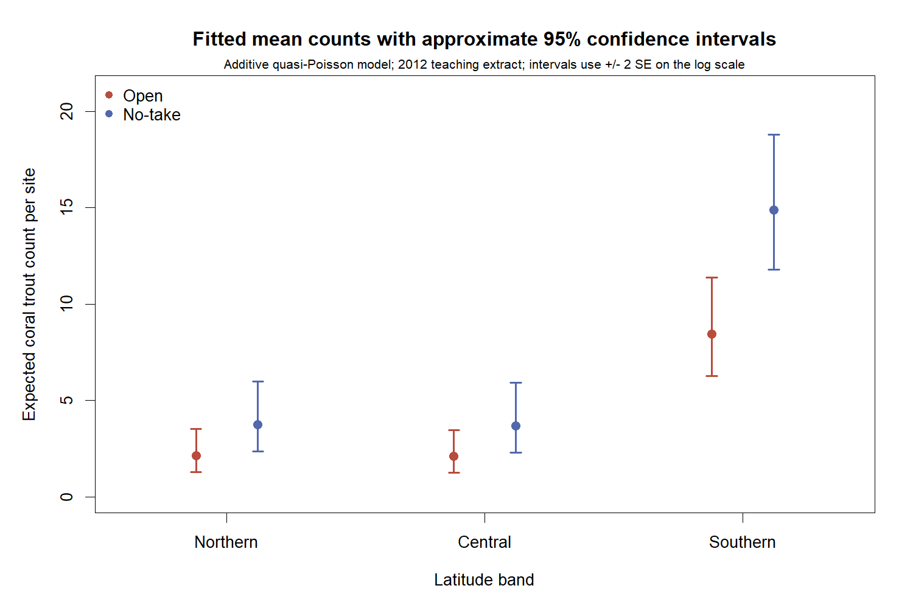
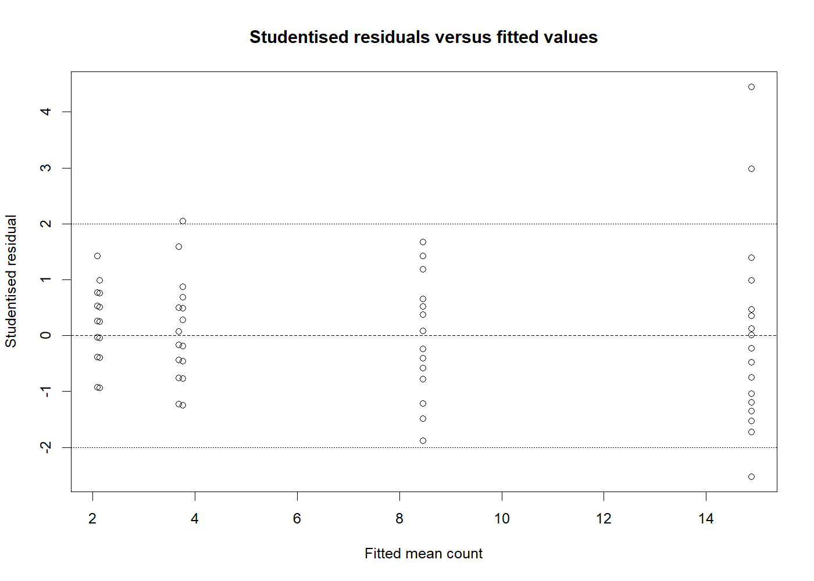

# Coral Trout Abundance: GLMs and Overdispersion

## 中文概览

### 大堡礁珊瑚鳟丰度的统计建模

基于 2012 年大堡礁监测数据的教学摘录，分析珊瑚鳟数量与纬度带、捕捞分区之间的关系，比较不同计数模型，并评估估计结果的不确定性。

- **个人工作**：独立完成数据探索、Poisson 与 quasi-Poisson 模型构建、交互项检验、残差与影响点诊断、敏感性分析及报告撰写。
- **主要方法**：从 Poisson 对数链接模型出发，检查过度离散后使用 quasi-Poisson 调整方差；比较加性模型与交互模型，解释预期计数比和置信区间。
- **主要结果**：120 个站点的数据呈明显过度离散，离散系数约 **5.38**。控制纬度带后，禁捕区的预期计数约为开放捕捞区的 **1.76 倍**，近似 95% 置信区间为 **1.24–2.49**。
- **结果复核**：R 代码已重跑。去掉两个影响较大的站点后，分区差异估计减小，但方向与原分析一致；主分析保留全部站点。

数据属于观察性调查，上述分区差异是关联，不能直接解释为禁捕政策的因果效果。完整模型比较、诊断图和复现方式见下方说明。

[阅读分析报告（PDF）](reports/coral-trout-analysis-report.pdf)

## English documentation

Model site-level coral trout counts using an AIMS-derived teaching extract, with attention to how overdispersion changes model selection and uncertainty. This is an individual statistical modelling project with a consulting-style written report.

### Reproduced findings

| Quantity | Result | Meaning |
| --- | ---: | --- |
| Sites | 120 | Five equal-length transects aggregated per site |
| Poisson interaction-model dispersion | 5.3776 | Substantial extra-Poisson variability |
| Initial Poisson interaction test | p = 0.0091 | Provisional comparison before checking dispersion |
| Quasi-Poisson interaction F test | p = 0.4199 | Insufficient evidence to retain the interaction |
| Final No-take/Open expected-count ratio | 1.7599 | Adjusted for latitude band, under the additive model |
| Approximate 95% ratio interval | 1.2419–2.4938 | Plus/minus two standard errors on the log scale |

The interaction is initially supported under the Poisson variance assumption, but not after allowing for extra variability. The additive quasi-Poisson model is retained. This does not prove that zone associations are identical across latitude bands.



Intervals describe uncertainty in expected site counts, not prediction intervals for a new site's observed count. All fitted estimates are in [fitted-counts.csv](results/fitted-counts.csv).

### Diagnostics and sensitivity

Inspect studentised residuals, leverage and Cook's distance. AIMS022 and AIMS024 affect the magnitude of the estimates. The No-take coefficient decreases from 0.5652 (all sites) to 0.4626 (without AIMS022) and 0.3817 (without both). All sites remain in the primary fit.



See [site diagnostics](results/site-diagnostics.csv), [sensitivity estimates](results/sensitivity.csv) and the [public report](reports/coral-trout-analysis-report.pdf).

### Run

R 4.5.2, ggplot2 4.0.2 and knitr 1.51 were used for the reproduced run. Install ggplot2 and knitr if needed, then run from the repository root:

```sh
Rscript run_analysis.R
```

This writes seven PNG figures, fitted estimates, model comparison, coefficients, group summaries, site diagnostics, sensitivity results and a validation record to results/. Original numeric results are reproduced. Display jitter is seeded for repeatable plots.

The readable analysis source is [analysis.qmd](analysis.qmd). With Quarto and its R dependencies installed, `quarto render analysis.qmd` renders the report source; Quarto HTML compilation was not executed during this curation. The PDF preserves the completed original analysis with a new title/provenance page and course requirements removed.

### Data and contribution

The supplied [120-site extract](data/aims_coral_trout_sites_2012.csv) derives from the Australian Institute of Marine Science (AIMS) Long-Term Monitoring Program visual-census fish dataset. The course selected 2012 records, aggregated all recorded Plectropomus species over five equal-length transects per site, anonymised site identifiers and assigned broad latitude bands. Those bands are teaching categories, not official management regions. Data acknowledgement and exact provenance are in [data/README.md](data/README.md).

Kunze (Charlotte) Lyu completed the individual MAST30027 coursework analysis and report at the University of Melbourne in 2026. Portfolio curation adds a standalone runner, checks, machine-readable exports, a fitted-count figure and documentation. See [contributions](docs/CONTRIBUTIONS.md) and [review notes](docs/REVIEW.md).

### Interpretation limits

This is a single-year observational analysis. Habitat, survey conditions, reef structure and other unmeasured differences could affect the zone association. Site independence cannot be verified from anonymised identifiers. Quasi-Poisson adjusts dispersion but does not model spatial dependence or establish causality. Negative-binomial and spatial alternatives were not benchmarked. AIC is used only for the fully specified Poisson models, not for quasi-likelihood model selection. No forecast or operational policy-impact estimate is claimed.
